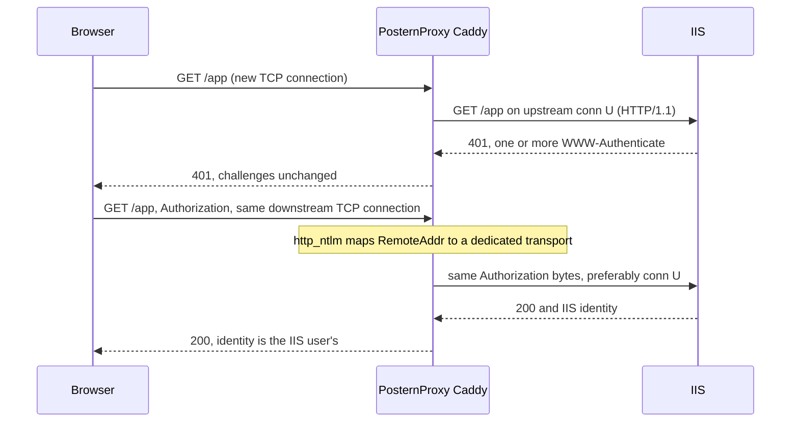
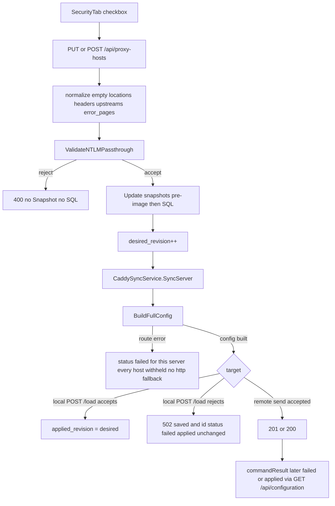

# NTLM authentication passthrough for HTTP Proxy Hosts

| | |
|---|---|
| Author | _unassigned_ |
| Date | 2026-11-26 |
| Status | Draft |
| Spec | `.agentplans/feature-ntlm-passthrough-spec.md` (Draft; not implemented) |
| Scope | Design and PR plan only. No product code, tests, changelog, or build changes in this document. |

## Overview

Administrators need one HTTP proxy host to forward a browser's NTLM (or Negotiate-wrapped NTLM) exchange to a single IIS application. IIS authenticates the user. PosternProxy only preserves the connection-scoped exchange. It does not collect passwords, store Windows credentials, enroll in Active Directory, or accept NTLM on the management API.

The first version adds a per-host boolean, `ntlm_enabled`, default false. When it is set, the existing Caddy route builder emits `transport.protocol = "http_ntlm"` from the pinned `github.com/caddyserver/ntlm-transport` module, which is compiled into the standard managed Caddy artifact. The same controller, the same outbound agent, and the same desired-versus-applied revision path carry the generated JSON. No second install variant and no subscription gate are introduced.

This remains a draft until a module pin newer than the rejected commit `a593c877` is built against Caddy `v2.11.9` / `go1.26.11`, and until acceptance criteria AC7–AC11 have real evidence. Those criteria are not claimed here. The docs PR does not execute them.

## Background & Motivation

IIS integrated Windows authentication is connection-oriented. A typical browser exchange is a `401` with one or more `WWW-Authenticate` challenges, then a follow-up request on the same downstream connection carrying `Authorization: NTLM` or `Authorization: Negotiate`, then an authenticated response. Caddy's default `http` reverse-proxy transport is free to use another upstream connection, HTTP/2 to the upstream, or a shared pool. Any of those breaks the IIS security context or, worse, can attach one user's authenticated upstream connection to another user's request.

PosternProxy already terminates or re-encrypts HTTP at Caddy and forwards to one primary upstream (`forward_scheme`, `forward_host`, `forward_port`) with optional extra upstreams, locations, header rewrites, and custom error pages. The relevant code is:

- Route generation: `BuildProxyHostRoute` and `buildReverseProxyRoute` in `internal/caddy/routes.go`. Both transports are hardcoded to `protocol: "http"`. Upstream TLS is only `TLSOptions{HandshakeTimeout: "10s"}` when `forward_scheme == "https"`. `InsecureSkipVerify` is never set on proxy-host routes.
- Persistence: `proxyHostColumns`, `Create`, `Update`, and `scanProxyHostRow` in `internal/services/proxy_host.go`, and the `proxy_hosts` table in `internal/database/migrations/001_initial.sql`.
- Apply path: SQLite triggers in `internal/database/migrations/003_config_state.sql` bump `server_config_state.desired_revision`. `CaddySyncService.SyncServer` posts the full JSON to local Caddy `POST /load` or sends the existing `config_full_sync` agent message. `applied_revision` advances only after success (`internal/services/config_state.go`).
- Build contract: `internal/caddybuild/build.sh` pins Caddy `v2.11.9`, xcaddy `v0.4.6`, Go `go1.26.11`, `caddy-l4` `v0.1.1`, `caddy-ratelimit` `v0.1.0`, and the security replacements. `scripts/build.ps1` parses that file and repeats the `xcaddy --with` arguments. `VerifyArtifact` checks Go build info.

The module that already implements the connection map is `http.reverse_proxy.transport.http_ntlm`. Reimplementing the handshake inside PosternProxy is out of scope and would make this process a Windows identity provider.

### What the inspected module actually does

Source read on 2026-11-26 from `https://github.com/caddyserver/ntlm-transport` `master`, file `ntlm.go`, which matches commit `a593c877efa2305832596a2d48432de38abd273d` (2026-09-14, merge of PR #11, "Cleanup: release transportsMu before closing idle connections"). `go.mod` on that same tree requires `github.com/caddyserver/caddy/v2 v2.11.4` and `go 1.25.1`. The file header is Apache License 2.0. This revision was **not** built against PosternProxy's pins. It is recorded as reviewed and **rejected** as the commit to compile: `RoundTrip` returns on `newTransport` error while `transportsMu` is still held. Do not pass `a593c877` to `xcaddy --with`. The pin is a later immutable commit that unlocks before returning. See Open Questions. No pseudo-version is guessed in this draft.

Observed behavior of that `NTLMTransport`:

- Module ID: `http.reverse_proxy.transport.http_ntlm`. `CaddyModule.New` allocates an embedded `*reverseproxy.HTTPTransport`.
- `Provision` forces `Versions = []string{"1.1"}` before calling `HTTPTransport.Provision`. In Caddy `v2.11.9` `modules/caddyhttp/reverseproxy/httptransport.go`, `"1.1"` is an allowed version and is not passed to `http2.ConfigureTransport`. Upstream HTTP/2 and HTTP/3 are not negotiated by this transport.
- Keep-alive is forced only when `HTTPTransport.KeepAlive` is already non-nil (`Enabled = true`). Our generator does not emit `keep_alive`, so the pointer is nil at that line. `HTTPTransport.Provision` then installs the Caddy default `KeepAlive` (idle timeout 2 minutes, `MaxIdleConnsPerHost` 32) and leaves `DisableKeepAlives` at the Go default, which is keep-alive **on**. The module README on the same commit says "Keep-Alive is always disabled." That README is wrong for this source. Do not document or test against the README.
- `RoundTrip` keys `map[string]*http.Transport` by `req.RemoteAddr`. The first time the request's `Authorization` values have prefix `NTLM` or `Negotiate` (case-sensitive on the value, canonical header name), it allocates a dedicated transport and stores it. Later requests with the same `RemoteAddr` reuse that transport. The map entry is removed when the wrapped upstream connection's `Close` runs. `Cleanup` (Caddy reload and stop) swaps the map out under the lock and then calls `CloseIdleConnections`, which is the deadlock fix in this commit.
- It does **not** set `MaxConnsPerHost`. Caddy's `NewTransport` copies `MaxConnsPerHost` straight through; `0` means unlimited. One downstream address therefore maps to one `*http.Transport`, not to a proven single upstream socket. Concurrent requests on that transport can dial more upstream connections.
- `newTransport` failure returns `nil, fmt.Errorf(...)` before `n.transportsMu.Unlock()`. A failed `NewTransport` deadlocks later `RoundTrip` calls on that handler. That leak is why `a593c877` is rejected. Do not compile it, and do not vendor a patch that unlocks.
- The dial wrapper type-asserts `caddyhttp.OriginalRequestCtxKey` to `http.Request`. A dial context without that key panics.
- A failed upstream dial leaves the map entry in place until `Cleanup` or a later successful connection close. `RemoteAddr` includes the client's ephemeral port, so a leaked entry is not reused by another TCP connection unless the port is reused and the entry is still present.
- The key is `req.RemoteAddr` only. `X-Forwarded-For`, `X-Real-IP`, and `{http.vars.client_ip}` are not consulted.

Those limits are why the first version supports only a direct browser-to-PosternProxy connection, one upstream, and refuses configuration that can strip `Authorization` or `WWW-Authenticate`. They are also why AC8 and AC11 are release gates rather than comments.

## Goals & Non-Goals

### Goals

- Opt-in per proxy host, database default false. Missing JSON on old rows, old backups, and history snapshots means false.
- One upstream, `forward_scheme` `http` or `https`. HTTPS keeps today's TLS object and never sets `insecure_skip_verify`.
- Reject, without discarding the operator's other fields, any NTLM host that also has nonempty extra upstreams, nonempty locations, `tls_passthrough`, nonempty advanced route JSON (except the generator's empty forms `""` and `"{}"`), a custom header rule that can change request `Authorization` or response `WWW-Authenticate` (wildcard deletes and an exact delete of those names), or a custom error page whose key `fmt.Sscanf` reads as `401` with a non-empty body.
- Same rejection on create, update, backup import, portable restore, and history rollback. A rejected write does not change the host row or `desired_revision`.
- Enabled hosts emit `http_ntlm`. Disabled hosts emit `http`. Access lists, rate limits, HSTS, health checks, and unrelated header rules stay.
- Standard Caddy artifacts gain the pinned module. Local and agent apply keep today's revision machine. A Caddy without the module fails the apply, keeps the previous running config, and does not advance `applied_revision`.
- Audit and history can represent the boolean without recording credentials or raw challenges.
- Acceptance tests for AC1–AC11 are written from the outcomes in the spec before the production change they judge.

### Non-goals

- SSO, Kerberos constrained delegation, AD enrollment, Windows credential storage, or NTLM on the management listener (`internal/auth`, `/api/auth/login`).
- Automatic IIS or Extended Protection changes. No installer step edits IIS.
- NTLM load balancing, extra upstreams, location upstreams, or failover. A stored `lb_policy` with no extra upstreams is not a conflict and is not cleared.
- Treating `X-Forwarded-For` or any client header as the connection identity. Additional HTTP proxies and CDNs are not supported topologies.
- A global downgrade of `:443` to HTTP/1.1. `servers.http2_enabled` stays an operator control for the whole server.
- Agent protocol fields, capability negotiation, or a second Caddy build flavor.
- Marking the spec Built, moving it to `.agentplans/completed/`, or calling AC7–AC11 verified.
- Making this feature a prerequisite of `.agentplans/stable-release-exit-criteria-2026-11-26.md`, `.agentplans/next-release-security.md`, or `.agentplans/beta-exit-config-lifecycle.md`.

## Key Decisions

1. **Use the upstream module; do not reimplement NTLM.** The handshake and the connection map stay inside `http.reverse_proxy.transport.http_ntlm`. PosternProxy only decides whether to emit that protocol. A homemade handshake would put credentials in this process.

2. **One standard artifact, no commercial-only build.** `build_caddy` in `internal/caddybuild/build.sh` gains one pinned `--with`. Dockerfiles, `scripts/build.sh`, provisioning (`internal/caddybuild.Script`), and installers already consume that function or `VerifyArtifact`. AGPL builds and commercially licensed builds stay the same bits. The feature does not add a hosted-service entitlement or a way for a third party to ship a proprietary NTLM edition without a license from the owner.

3. **The exact module version is not chosen in this draft, and `a593c877` is not the commit to compile.** Tags stop at `v0.1.2` (`abdbda2c`, 2022-07-13), which is older than the deadlock fix and older than the module's own Caddy `v2.11.4` bump. `master`, `latest`, and `a593c877` are not pins. That commit was source-reviewed on 2026-11-26 and rejected because `RoundTrip` returns before unlocking when `newTransport` fails. PR 3 is blocked on a newer upstream commit that unlocks before returning. The pseudo-version procedure runs on that commit only, after it exists. This document does not guess the pseudo-version. Persistence work (PR 1) may merge before that commit exists. No release emits `http_ntlm` until PR 3 exists. Do not vendor a patch.

4. **Fail closed on conflicts and on a missing module.** NTLM validation runs after empty-field normalization and before any host write or history snapshot. The route builder also refuses an inconsistent in-memory host so a row that bypassed the API cannot emit `http` for an NTLM host or a second upstream. `BuildFullConfig` returns on the first such error, so one poisoned row withholds the new config for every host on that server. Caddy `POST /load` remains the atomic swap: a rejected load leaves the previous process config in place. There is no fallback that rewrites `http_ntlm` to `http`.

5. **Do not change shared listeners in this version.** Downstream protocol is a qualification gate. If a real browser on HTTP/2 or HTTP/3 shares one `RemoteAddr` across users, or if one transport opens a second upstream socket under concurrency, shipping stops. A listener change needs a separate proposed decision because `HTTPServer.Protocols` in `internal/caddy/config.go` is server-wide.

6. **Reuse the host service, the full-update body, and the Security tab.** `CreateProxyHostInput` grows one boolean. `PUT /api/proxy-hosts/{id}` stays a full replace. The checkbox is a native labeled control on `SecurityTab.vue`, with the spec's help sentence verbatim. No credential or domain inputs.

7. **Tests encode outcomes, then implementation catches up inside the same mergeable PR.** `go test ./...` must be green to merge. On the branch, the new tests are written first and are red for the right reason; the implementation commit turns them green. A skipped test is not an AC pass. AC7–AC11 stay pending until a later qualification change records a real run. PR 5 does not perform that run.

## Proposed Design

### Topology



Supported path: the browser connects to PosternProxy. PosternProxy connects once, logically, to one IIS upstream over HTTP or HTTPS with verification left at Caddy's default trust. Unsupported path: a CDN or forward proxy that multiplexes several users onto one TCP connection. Those users would share one `RemoteAddr` and therefore one transport.

`buildReverseProxyRoute` still sets `X-Real-IP` and `X-Forwarded-For` from `{http.vars.client_ip}` via `clientHeaders`. That is existing upstream metadata. The NTLM map does not read it. Trusted-proxy configuration (`TrustedProxies` / `ClientIPHeaders` in `BuildFullConfig`) must not be reused as an NTLM key.

If any other host on the same server has `tls_passthrough`, `BuildFullConfig` moves `:443` to layer 4 and bridges other HTTPS hosts, including an NTLM host, through `127.0.0.1:8443` with PROXY protocol v2 (`internalHTTPSAddr` in `internal/caddy/config.go`). The NTLM host itself still cannot set `tls_passthrough`. Coexistence with somebody else's passthrough host is not part of the supported topology until AC8 covers it. v1 does not add a new cross-host rejection.

### Validation

Add `ValidateNTLMPassthrough` next to the existing host checks (proposed home: `internal/models`, so `internal/services` and `internal/caddy` can share it without an import cycle).

Call it from `ProxyHostService.Create` and `Update` only after the empty-field normalization already in `internal/services/proxy_host.go`, and still before `history.Snapshot` and before any `INSERT` or `UPDATE`. A nil or empty `json.RawMessage` is not a JSON array. The helper must not see those values. The order is:

1. `validateProxyHostInput` and `validateAdvancedConfig`, unchanged and still first.
2. The existing normalization. `string(input.Locations) == ""` becomes `[]`. `len == 0` on `custom_headers` and `extra_upstreams` becomes `[]`. `len == 0` on `error_pages` becomes `{}`. An empty `lb_policy` becomes `random`.
3. `ValidateNTLMPassthrough` on that normalized input. Post-normalization `[]` and `{}` are allowed.
4. On `Update` only, `history.Snapshot` of the pre-image loaded by `GetByID`. Do not move `Snapshot` ahead of normalization. A rejected update writes no history row.
5. `INSERT` or `UPDATE`.

`Update` today snapshots and only then validates. Moving the existing validators, the normalization, and the NTLM helper above `Snapshot` removes a history row for every rejected update, including today's domain and advanced-config errors. Successful updates still snapshot the pre-image before SQL. `Create` already snapshots the new row after commit; leave that success path, and run the helper after normalization and before `BeginTx`.

A test omits `custom_headers`, `locations`, `extra_upstreams`, and `error_pages`, sets `ntlm_enabled` true, and asserts the row is stored with those defaults (`[]`, `[]`, `[]`, `{}`) and the flag on. That is the nginx-confirm shape and the shape of any client that only sends the boolean.

The function returns nil when `ntlm_enabled` is false, leaving combinations that are legal for ordinary hosts untouched.

When `ntlm_enabled` is true, reject with `fmt.Errorf` (HTTP 400 `{"error":"..."}` through the existing `respondServiceError`) if any of the following hold. Do not mutate the stored row to "fix" it.

| Condition | Why |
|---|---|
| After normalization, `extra_upstreams` is not a JSON array, or `len > 0` | `[]` is allowed. Nonempty includes incomplete objects the generator would skip. A stored default `lb_policy` (`random`, including `""` which step 2 turns into `random`) is ignored. |
| After normalization, `locations` is not a JSON array, or `len > 0` | `[]` is allowed. Location routes call `buildLocationRoute`, which always emits protocol `http`. Invalid JSON is not treated as empty. |
| `tls_passthrough` | That host is queued on the layer-4 passthrough path and never hits `buildReverseProxyRoute`. |
| `advanced_config` after `strings.TrimSpace` is not `""` or `"{}"` | `advancedConfigJSON` shallow-merges every other value over the route in `Route.MarshalJSON`, which can replace `handle` and drop the transport. `" { } "` is not empty today and stays rejected. Do not loosen `advancedConfigJSON` in this feature. |
| A custom header rule can change request `Authorization` or response `WWW-Authenticate` | See below. Exact deletes are included. |
| After normalization, `error_pages` is not a JSON object, or `fmt.Sscanf(code, "%d", &n)` yields `401` and the body is non-empty | `{}` is allowed. `BuildErrorRoutes` does not require the whole key to be consumed, so `401`, `0401`, `401abc`, and `+401` all scan as 401. `static_response` replaces headers on a handler-generated status and would drop challenges. Empty bodies are already ignored by the generator. |
| After normalization, `custom_headers` is not a JSON array | `[]` is allowed. The generator ignores invalid JSON (`_ = json.Unmarshal`). NTLM must not. |

A proxied upstream `401` is a successful `reverse_proxy` response, not `http.error.status_code`. An error route does not strip `WWW-Authenticate` on that path. The `401` rejection is still required: `BuildErrorRoutes` replaces handler-generated 401s.

Header rule match, aligned with Caddy `v2.11.9` `modules/caddyhttp/headers/headers.go` rather than a general glob. Run `repl.ReplaceKnown` on the field name first, matching `HeaderOps.ApplyTo`, then classify.

- `operation` `set` or `add`: `http.CanonicalHeaderKey` is `Authorization` for `direction == "request"`, or `Www-Authenticate` for `direction == "response"`. Case folding is the canonical map. `set` of `*` does **not** write `Authorization`; do not reject it for that reason.
- `operation` `delete`: keep the wildcard arms, and add the default arm. After lowercasing, `*` matches every field, a leading `*` matches a suffix, a trailing `*` matches a prefix, and both match a substring. The fourth form is the `default` branch, `hdr.Del(fieldName)`. `http.Header.Del` canonicalizes, so exact `authorization` and `Authorization` are the same request rule, and exact `www-authenticate` and `WWW-Authenticate` are the same response rule. That exact delete is what the Headers tab emits (`operation: "delete"`, a concrete `name`). The wildcard arms do not cover it. An implementer who codes only the star forms will accept a rule the spec forbids.
- Any rule name containing `{` or `}` is rejected while NTLM is on, because `ReplaceKnown` can turn a placeholder into a protected name.
- Names containing CR, LF, or `:` are rejected while NTLM is on.
- Other directions and operations are unchanged: the generator already ignores them, and they do not match the protected fields.
- One forbidden rule rejects the save. Rules are not silently dropped.

AC3 rows the header and error-page tests must include:

| Direction | Operation | Name or key | Result |
|---|---|---|---|
| request | delete | `Authorization` | reject |
| request | delete | `authorization` | reject |
| response | delete | `WWW-Authenticate` | reject |
| response | delete | `www-authenticate` | reject |
| request | delete | `*` | reject |
| request | delete | `Auth*` | reject |
| request | delete | `*ization` | reject |
| request | delete | `*auth*` | reject |
| response | delete | `www-*` | reject |
| response | delete | `*authenticate` | reject |
| request | set | `Authorization` | reject |
| response | add | `www-authenticate` | reject |
| request | set | `*` | allow |
| request | delete | `X-Request-Id` | allow |
| error page | | `401` with a non-empty body | reject |
| error page | | `0401` with a non-empty body | reject |
| error page | | `401abc` with a non-empty body | reject |
| error page | | `+401` with a non-empty body | reject |
| error page | | `401` with an empty body | allow |
| omitted `custom_headers`, `locations`, `extra_upstreams`, `error_pages` | | | allow; persist `[]` / `{}` and `ntlm_enabled` |

Proposed error strings, stable enough for table tests:

- `NTLM passthrough requires a single upstream; remove extra upstreams or disable it`
- `NTLM passthrough cannot be combined with path locations`
- `NTLM passthrough cannot be combined with TLS passthrough`
- `NTLM passthrough cannot be combined with advanced route JSON`
- `NTLM passthrough cannot change the Authorization or WWW-Authenticate headers`
- `NTLM passthrough cannot use a custom 401 error page`
- `NTLM passthrough settings must be valid JSON`

`BuildProxyHostRoute` calls the same helper and returns the error. `BuildFullConfig` returns on the first `BuildProxyHostRoute` error (`internal/caddy/config.go`), before local `POST /load` and before `hub.Send`. One poisoned NTLM row therefore withholds the new config for every other host on that server. `applied_revision` stays where it was, the last loaded Caddy config keeps serving, and the database row is not rewritten and is not flipped to protocol `http`. The operator fixes or disables that host, then retries sync. Do not fall back to `http` for the one host. The upgrading note says the same thing.

Health checks, rate limits, access lists, HSTS, and `http_only` are allowed. Do not reject `hc_enabled` in v1. Active checks are the reverse-proxy `health_checks` block from `buildHealthChecks`. Caddy `v2.11.9` `doActiveHealthCheck` marks the upstream unhealthy on a non-2xx response or a mismatched `expect_status`. The form default expect status is 200, so a `401` probe takes the only upstream out of rotation. New requests fail until the operator disables the checks or points `hc_active_path` at an anonymous URL. That is fail-closed. It is not Extended Protection advice.

On this Caddy version the probe does not hit the module's dial assert. `doActiveHealthCheck` sets `caddyhttp.OriginalRequestCtxKey` to the `http.Request` before `httpClient.Do`, and the client uses `Transport: h.Transport`. The reviewed `ntlm.go` wraps `DialContext` only inside `newTransport`, which runs only when `Authorization` starts with `NTLM` or `Negotiate`. An unauthenticated probe uses `HTTPTransport.Transport` and never enters that assert. The panic remains real for an authenticated dial whose context lacks the key. That is not what this health checker does. Re-check the wrapped dialer at pin time if the pinned Caddy no longer sets the key. Open Question 5 is closed for `v2.11.9` and narrowed to that re-check.

### Route JSON

`buildReverseProxyRoute` selects the protocol:

```go
protocol := "http"
if h.NTLMEnabled {
    protocol = "http_ntlm"
}
transport := &Transport{Protocol: protocol}
if h.ForwardScheme == "https" {
    transport.TLS = &TLSOptions{HandshakeTimeout: "10s"}
}
```

`Transport` in `internal/caddy/types.go` already serializes `protocol` and optional `tls`. No new transport fields. Do not emit `versions`, `keep_alive`, `insecure_skip_verify`, or `max_conns_per_host`. The module's `Provision` owns upstream HTTP/1.1. Setting `max_conns_per_host` from PosternProxy would be a behavior patch on top of an unreviewed interpretation of the module; if AC8 shows a second upstream socket, stop and take that upstream rather than quietly capping it here.

Disabled hosts, and every non-NTLM host, keep `protocol: "http"`. `buildLocationRoute` is unchanged because locations are illegal together with the flag. Load-balancing JSON stays omitted for a single upstream (`len(upstreams) > 1` is the existing condition), even when `lb_policy` is `random`.

Rate-limit and access-list handlers stay in front of the subroute. The custom-headers handler stays where it is, which is before `reverse_proxy`, so a rejected rule cannot run. HSTS still sets only `Strict-Transport-Security`.

### Apply, agents, and a missing module

No new `Kind*` and no change to `ConfigFullSyncPayload` or `CommandResultPayload` (`internal/agent/protocol.go`). The flag exists only inside the host row and the generated Caddy JSON.

Today's machine already matches the failure contract, with one split between local `/load` and a remote send:

1. The host `UPDATE` commits and the `proxy_hosts_config_update` trigger increments `desired_revision` and sets `queued`. The same trigger runs on `INSERT`.
2. `SyncServer` marks `applying`, then `applyServer` (`internal/services/caddy_sync.go`).
3. Both targets call `BuildFullConfig` on the controller. If that returns an error, `applyServer` returns before any load. `SyncServer` marks `failed` and returns `*ConfigApplyError` for a local server and for a remote server. One poisoned row blocks every host on that server. `applied_revision` does not move. Do not fall back to `http`.
4. Local server (`serverID == 1`): `caddy.Client.LoadContext` does `POST /load`. Caddy validates before replacing the running config. A missing module fails the load, the previous config keeps serving, `applied()` is not called, and `SyncServer` returns `*ConfigApplyError`. The HTTP handler can answer 502 in that same request.
5. Remote server: after a successful `BuildFullConfig`, `hub.Send` of the existing `config_full_sync` returns and `applyServer` returns nil. `SyncServer` returns nil. The handler answers 201 (`Create`) or 200 (`Update`). The missing-module result arrives later in `commandResult`, which sets `status` to `failed` and does not call `applied()`.
6. `commandResult` ignores stale command IDs and revisions. The agent still reports `Success: false` and puts `caddyLoad`'s `err.Error()` in `CommandResult.Error` (`cmd/posternproxy-agent/main.go`). That field already exists. Do not add a protocol field.
7. `ConfigurationStatus.vue`, mounted from `AppLayout.vue`, polls `GET /api/configuration` and admins can `POST /api/servers/{id}/resync`. That is the retry control for both targets. Do not add another. AC6 and AC10 for an agent target are this poll (`failed` versus `applied`), not the HTTP status of the save.

The gap is the text. Local failure is stored as "Configuration application failed; retry or check server connectivity." Agent failure is stored as "Agent rejected configuration. Check the server and retry synchronization." `CommandResult.Error` is discarded. The two clients wrap the admin body differently, and neither stores a plain-text `module not registered` line.

Verified on 2026-11-26 against Caddy `v2.11.9` and this tree. `POST /load` of JSON takes this path:

- `LoadModuleByID` returns `unknown module: %s` (`context.go`). For this transport the id is `http.reverse_proxy.transport.http_ntlm`. `GetModule`'s `module not registered: %s` (`modules.go`) is not the `/load` path.
- The transport object uses inline key `protocol`. `loadModuleInline` wraps the failure as `loading module 'http_ntlm': unknown module: http.reverse_proxy.transport.http_ntlm` (`context.go`).
- `changeConfig` returns a plain error, `loading new config: %v` (`caddy.go`). It is not an `APIError`.
- `handleLoad` wraps that as `APIError` with `HTTPStatus` 400 and `loading config: %v` (`caddyconfig/load.go`). `handleError` copies `Err.Error()` into `Message` and JSON-encodes `{"error":"..."}` (`admin.go`). `json.Encoder` adds a trailing newline. Status 500 is what `handleError` uses when the handler error is not an `APIError`. This `/load` failure is an `APIError`, so the status on this path is 400.
- `internal/caddy/client.go` stores `caddy POST /load returned %d: ` plus that entire body (`caddy %s %s returned %d: %s`).
- The agent stores a different wrapper, `caddy POST /load: status %d: ` plus the same body (`cmd/posternproxy-agent/main.go` `caddyRequest`, `caddy %s %s: status %d: %s`, any status `>= 300`).

The module id appears only inside the JSON `error` string. Stripping that object leaves a prefix with no id, and the stable sentence would never be stored. Do not do that. Do not use `strings.Contains` on the raw body. Do not require status 400: this path is 400 today, and a later Caddy that returns another status with the same decoded phrase must still match.

Change only the string passed to the existing `error` column. Decode the admin error, then match one phrase:

1. Take the local load error or `CommandResult.Error`.
2. From the first `{`, unmarshal the remainder into a struct whose `error` field is a string. `json.Unmarshal` accepts the trailing newline.
3. If that fails, or `error` is empty, keep today's generic sentence. Do not search the raw body.
4. If the decoded string contains `unknown module: http.reverse_proxy.transport.http_ntlm`, store `Caddy rejected the configuration because the NTLM transport module is missing. Upgrade Caddy on this server and retry sync.`
5. Otherwise keep the generic sentence. Intermediate wraps between `loading new config` and `loading module 'http_ntlm'` are not part of the match.

`module not registered` does not select the sentence, with or without the module id. `unknown module:` plus a different id does not either. A submitted config document whose only copy of the id is inside a JSON string does not: it has no decoded admin `error` containing that phrase. Generated JSON uses `"protocol": "http_ntlm"`, not the module id.

`internal/services/config_state_test.go` locks this in. The positive rows are the two wrappers around the same JSON body. The phrase inside `error` is `loading config: loading new config: loading module 'http_ntlm': unknown module: http.reverse_proxy.transport.http_ntlm`. Tests may include further wraps; the match does not depend on them. Include the trailing newline.

| Error text | Stored sentence |
|---|---|
| `caddy POST /load returned 400: {"error":"loading config: loading new config: loading module 'http_ntlm': unknown module: http.reverse_proxy.transport.http_ntlm"}` plus newline | NTLM sentence. This is the controller wrapper. |
| `caddy POST /load: status 400: {"error":"loading config: loading new config: loading module 'http_ntlm': unknown module: http.reverse_proxy.transport.http_ntlm"}` plus newline | NTLM sentence. This is the agent wrapper on the same body. |
| `caddy POST /load: status 500: {"error":"loading config: loading new config: unknown module: http.reverse_proxy.transport.http_ntlm"}` plus newline | NTLM sentence. The status number is not part of the match. |
| the controller wrapper whose decoded `error` is `unknown module: http.handlers.rate_limit` | generic |
| `module not registered` with no module id | generic |
| `module not registered: http.reverse_proxy.transport.http_ntlm` with no `unknown module:` phrase | generic. That is `GetModule`, not `/load`. |
| the generated config only, including `"protocol": "http_ntlm"` | generic |
| the generated config only, with the module id pasted into a JSON string | generic |
| `SECRET-REJECTION-BODY` | generic, and the sentinel is not stored |
| `PRIVATE KEY SENTINEL` | generic, and the sentinel is not stored |

Never copy the raw Caddy body into logs or `server_config_state.error`. Do not log the load error or `CommandResult.Error` with zerolog `Err(err)`; that prints the Caddy body. Log `server_id`, revision, and the stable sentence only. The existing `Err(err)` on a failed `mark` is the database error and may stay. Do not log `Authorization`, challenges, cookies, or the config document.

Disabling the flag is an ordinary `Update`. The next successful load emits `http`. In-flight authenticated upstream connections are dropped by Caddy's transport `Cleanup` on reload. The spec does not require those sessions to survive.

`Create` and `Update` in `internal/api/handlers/proxy_hosts.go` both drop the `*ProxyHost` when `err != nil` and call `respondServiceError`. The service already returns the saved host together with the error (`return host, syncServers(...)`). `syncServers` returns that error unwrapped. `respondServiceError` in `internal/api/handlers/respond.go` is shared by redirection, dead, and stream hosts. Leave `respond.go` unchanged.

Branch in `ProxyHostHandler.Create` and `Update` before `respondServiceError`, and only when `errors.As` yields `*ConfigApplyError` and the returned host is non-nil. That response is 502 `{"error","saved":true,"server_id","id"}`. It covers a local `/load` failure and a controller-side `BuildFullConfig` failure for either target. The form stays open. The checkbox stays at the saved value. `id` turns a failed create into an edit so a retry does not insert a duplicate. Validation errors stay 400 and include no id.

A remote send that `applyServer` accepted is not this branch. The handler returns 201 or 200 with the host. There is no 502 and no error `id` on that path. AC10 must not require `id` for an agent target. Truth is `GET /api/configuration` (`failed` versus `applied`). `ConfigurationStatus` stays the retry control. Do not treat 201 or 200 as proof the remote Caddy loaded the module.

### UI

`SecurityTab.vue` is the TLS-passthrough and rate-limit tab. It is mounted only after Advanced Settings (`ProxyHostFormModal.vue`). That is the same discoverability as TLS passthrough. The spec places the control on the Security tab, not on the basic page.

The control is a real `<input type="checkbox">` inside a `<label>`, following the TLS passthrough block. Visible label: `NTLM authentication passthrough`. Help text, exact:

> Pass Windows authentication through to IIS. Requires a single upstream and compatible IIS Extended Protection settings. Uses more upstream connections.

No username, password, domain, or SPN fields.

`useProxyHostForm.ts`:

- `defaultForm` sets `ntlm_enabled: false`.
- `init` copies `host.ntlm_enabled ?? false` and includes it in the `showAdvanced` condition, next to `tls_passthrough`, so reopening an enabled host lands in the tabs instead of hiding the flag.
- `save` always sends `ntlm_enabled`. Basic-mode save must not drop it.
- On failure, set `saveError` with `errorMessage` from `frontend/src/utils/errors.ts`. The composable today uses `Error.message`, which for Axios is "Request failed with status code 400" and hides the server sentence.
- Do not reset `form` on error.
- Client-side checks may switch `activeTab` and set the same sentences, but the server remains authoritative. Client checks must not delete locations, upstreams, headers, or advanced JSON.
- A local 502 body with `saved: true` and `id` is shown as saved-but-not-applied, not as a validation rollback. The modal stays open. The checkbox stays at the saved value. If `id` is present, the modal treats the host as existing so a retry does not call Create again.
- A 201 or 200 for a remote server is send-accepted, not applied. The form keeps the saved checkbox. `ConfigurationStatus` on the layout is what shows `failed` or `applied`. Do not require a 502 `id` for that path.

`ProxyHost` and `CreateProxyHostInput` in `frontend/src/types/index.ts` and `frontend/src/api/proxyHosts.ts` gain `ntlm_enabled?: boolean` on the write model and `ntlm_enabled: boolean` on the read model.

### Import, history, nginx

Backup export is `SELECT *`. After the migration, exports contain `ntlm_enabled`. `tableColumns["proxy_hosts"]` in `internal/services/backup.go` must list it or `validateBackup` / `insertRow` reject the export as an unknown column.

`BackupService.Import` and `RestorePortable` each open a transaction and call `replaceBackupTables` (`internal/services/backup.go`, `internal/services/portable_backup.go`). `RestorePortable` does not call `Import`. A check that lives only in `Import` lets an encrypted portable restore commit `ntlm_enabled` together with locations. Call `ValidateNTLMPassthrough` from `replaceBackupTables` before any `proxy_hosts` insert, on every row, and return the error so that transaction does not `Commit`. `defer tx.Rollback()` undoes the `DELETE` and the `desired_revision` trigger updates only when that validation runs inside the transaction before `Commit`. Do not skip the bad host.

Backup rows are `map[string]any`. `dumpTable` turns `[]byte` into `string`, so `locations`, `extra_upstreams`, `custom_headers`, and `error_pages` arrive as JSON text. Decode those strings with the same conflict rules. A missing container key with the flag true is empty and allowed, matching the API default after normalization. A missing container key with the flag false is the old-backup case and is allowed even when some other column is nonempty.

`ntlm_enabled` is not an `int` and not only a JSON bool. Accept only:

- Absent key: false, so old backups still load.
- `int64` `0` or `1`. `dumpTable` stores SQLite integers as `int64` (`database/sql`). This is the in-memory export path, `Export` into `Import` without a JSON round-trip.
- `float64` `0` or `1` that is an integer (`v == float64(int64(v))`). `json.Unmarshal` decodes numbers as `float64`. This is what `UnmarshalPayload` and `RestorePortable` see.
- JSON `true` or `false` (`bool`).

Reject strings (`"1"`, `"true"`), non-integer numbers (`1.5`), other numbers (`2`, `-1`), and every other kind, including a plain `int`. The whole restore fails.

Tests cover both paths. An in-memory export round-trips a host with the flag set and a host with it unset through `Import`. A JSON portable restore of the same rows round-trips through `RestorePortable`. A portable payload with `ntlm_enabled` true and nonempty locations fails before commit and leaves the previous hosts in place. The portable case is a portable-restore test, not only `backup_test.go`.

History rollback is already `registerRollbackHandlers` in `internal/app/app.go`, which unmarshals a `models.ProxyHost` into `CreateProxyHostInput` and calls `Update`. Add `NTLMEnabled: h.NTLMEnabled` to that literal. Snapshots written before the field exist unmarshal as false. `Update` revalidates, so a snapshot that combines the flag with locations is refused and does not write.

`ConfigHistoryService.List` replaces every non-null snapshot with `{}` and the stored blob is `enc:v1:` ciphertext (`internal/services/config_history.go`). The safe representation of the flag is the boolean inside that encrypted pre-image, plus the audit allowlist below. Do not start returning decrypted snapshots to the UI.

`hostAuditSnapshot` in `internal/services/audit.go` copies an allowlist of keys and drops `custom_headers` (covered by `Test` behavior in `internal/services/config_state_test.go` with an `Authorization` sentinel). Add only `"ntlm_enabled"`. Do not add header, cookie, or advanced-config keys.

`NginxImportService.Confirm` builds `CreateProxyHostInput` without the new field, so the value is false, and it calls `Create`. Nginx configs cannot express this flag. Do not add an nginx directive. The existing per-host error list stays as it is; this feature does not turn nginx import into a single transaction. A hand-built API import is the backup path, which is atomic.

### Build contract

After a newer commit than `a593c877` exists and the pseudo-version procedure has resolved it, extend the shared contract. Do not add the module to the controller `go.mod`. The controller never imports it. Do not write `a593c877`, `v0.1.2`, `master`, or `latest` into `build.sh`. Do not vendor a patch.

`internal/caddybuild/build.sh`:

- `CADDY_NTLM_VERSION=<pseudo-version recorded by the procedure>`
- `verify_caddy` also requires the list-modules line `http.reverse_proxy.transport.http_ntlm <that version>`
- `build_caddy` adds `--with github.com/caddyserver/ntlm-transport@<that version>` after the existing plugins and still applies every `CADDY_SECURITY_REPLACEMENTS` entry

`internal/caddybuild/verify.go` adds `github.com/caddyserver/ntlm-transport` to the `want` map with `Replace == nil`. A wrong version, a replace directive, or a missing dep fails `VerifyArtifact`. Installers (`internal/installer/installer.go`, `install_windows.go`, `agent.go`, `artifacts.go`) and `internal/provisioner/systemd.go` already call `VerifyArtifact`. They pick up the new module without a second code path.

`scripts/build.ps1` is a separate parser. The regex lists six names and `Count -ne 6` throws `Invalid Caddy build contract`. Add `CADDY_NTLM_VERSION` to the regex, require seven pins, and add the third `--with`. `scripts/build.sh` only calls `build_caddy`, so it follows `build.sh`. Dockerfiles source `build.sh` the same way.

Update the fixtures that stub `list-modules`:

- `internal/caddybuild/build_test.go`
- `internal/caddybuild/build_test.sh`
- `internal/caddy/acceptance_test.go` and `internal/caddy/stream_acceptance_test.go` (buildinfo module map)

Preserve the existing security replacements and the L4 and rate-limit pins unchanged.

License recording follows the current practice, which is the plugin table in the README and installation docs plus `CHANGELOG.md`. There is no `NOTICE` file. The module is Apache 2.0. State that beside the pin. Do not create a new license workflow.

### IIS, Extended Protection, and downstream protocol

No compatibility matrix is claimed. Microsoft Extended Protection binds the authentication to the TLS channel the client used, or to a service principal. PosternProxy terminates the browser TLS (unless the host is `http_only`) and opens a different TLS session to IIS when `forward_scheme` is `https`. Channel binding computed by the browser will not match IIS's session. v1 therefore does not tell operators to set Extended Protection to None, and it does not set `insecure_skip_verify`.

The honest support sentence until AC7 evidence exists: NTLM passthrough is implemented but not verified against IIS. If qualification cannot find a configuration that keeps Extended Protection Require and still authenticates through a terminating proxy, the shipped docs narrow the claim and point at the existing TLS passthrough host for end-to-end TLS, instead of weakening verification.

Downstream HTTP/2 and HTTP/3 are whatever `BuildFullConfig` already emits. One NTLM host must not set `HTTPServer.Protocols` for every site. The existing per-server HTTP/2 switch (`servers.http2_enabled`, UI on `ServersView.vue`) restricts that server's HTTPS listener to `["h1"]` and is the operator mitigation if qualification forbids multiplexed downstream protocols. Do not flip it automatically.

### Request path through the components



## API / Interface Changes

Read and write bodies gain one field. Example write fragment:

```json
{
  "domain_names": ["app.example.com"],
  "forward_scheme": "https",
  "forward_host": "iis.internal",
  "forward_port": 443,
  "ntlm_enabled": true,
  "extra_upstreams": [],
  "locations": [],
  "tls_passthrough": false,
  "lb_policy": "random",
  "advanced_config": "{}",
  "custom_headers": [],
  "error_pages": {}
}
```

`decodeJSON` uses `DisallowUnknownFields`. Old clients that omit `ntlm_enabled` decode it as false and a full `PUT` turns the flag off. That is the existing full-update rule (`tls_passthrough` behaves the same way). There is no PATCH API.

| Call | Saved and local apply succeeded, or remote send accepted | Rejected NTLM combination | Local `/load` failed, or `BuildFullConfig` failed, after commit | Remote Caddy result |
|---|---|---|---|---|
| `POST /api/proxy-hosts` | 201 host, including `ntlm_enabled`. For a remote server this means the send was accepted, not that Caddy applied it. | 400 `{"error":"..."}`, no row | 502 `{"error","saved":true,"server_id","id"}`. Form stays open. Checkbox unchanged. | Not this response. `GET /api/configuration` is `failed` or `applied`. There is no 502 `id`. AC10 does not require one. |
| `PUT /api/proxy-hosts/{id}` | 200 host. Same remote caveat. | 400, previous row kept, no new history row, `desired_revision` unchanged | 502 as above, with the existing id. Same form rules. | Same poll. `ConfigurationStatus` is the retry control. |
| `GET` | 200, `ntlm_enabled` false when the column is 0 | | | |
| Viewer or no write scope | | 403 before the handler (`RequireAdmin` or `RequireManagementScope`) | | |
| No credentials | | 401 from the existing auth middleware | | |

Admin mutation, CSRF, and the API rate limiter stay on the mount in `internal/api/router.go` and `mountHostRoutes`. The flag grants no management privilege.

Generated transport fragment for an enabled HTTPS host:

```json
{
  "handler": "reverse_proxy",
  "upstreams": [{ "dial": "iis.internal:443" }],
  "transport": {
    "protocol": "http_ntlm",
    "tls": { "handshake_timeout": "10s" }
  }
}
```

A disabled host keeps `"protocol": "http"` and the same `tls` object when the scheme is HTTPS.

## Data Model Changes

Forward migration only. Do not edit `001_initial.sql`. `TestInitialMigrationIsFrozen` compares it to `internal/database/testdata/beta-exit-2026-10-24.sql`.

New file `internal/database/migrations/006_proxy_host_ntlm.sql`, same style as `004_dead_host_http_only.sql`:

```sql
ALTER TABLE proxy_hosts ADD COLUMN ntlm_enabled INTEGER NOT NULL DEFAULT 0;
```

SQLite applies a constant default to existing rows. `Migrate` records the filename in `schema_migrations`.

`proxyHostColumns`, `scanProxyHostRow`, the `INSERT` in `Create`, and the `UPDATE` in `Update` all gain `ntlm_enabled`, scanned as an integer and stored with `boolToInt`. `caddy_sync.go` `loadProxyHosts` uses `proxyHostColumns` and needs no second list.

`tableColumns` for `proxy_hosts` gains `"ntlm_enabled"`. Backup decoding of that column is `int64` or integer `float64`, not a Go `int`. The accepted set is in "Import, history, nginx".

No new table, no credential column, no backfill beyond the default. Expected storage is one integer per host.

History rows are not rewritten. `ProtectExisting` only encrypts legacy plaintext snapshots; leave it alone.

## Alternatives Considered

### 1. Pin tag `v0.1.2` because it is the highest tag

Rejected. That tag is commit `abdbda2c2e6f25b3e97ba408a7c6d2b78abacd6e` from 2022-07-13. The deadlock fix that makes `Cleanup` safe on reload landed on 2026-09-14 and is not in the tag. The module's current `go.mod` asks for Caddy `v2.11.4`; the tag predates that. A floating `master` or `latest` is also rejected by the spec.

Compiling `a593c877efa2305832596a2d48432de38abd273d` is rejected for a different reason. That commit is the source reviewed on 2026-11-26, and `RoundTrip` still returns before `transportsMu.Unlock()` when `newTransport` fails. It is not a build input. A newer upstream commit that unlocks first is required. A vendored unlock is not a substitute.

### 2. Vendor or fork the module inside this repository and set `MaxConnsPerHost = 1`

Rejected for v1. A fork would be an unreviewed transport, which the spec forbids, and it would put connection-policy bugs on the PosternProxy authors. If the candidate cannot provide isolation, the feature does not ship until upstream has a new immutable commit. A PosternProxy-side cap in generated JSON was also rejected: `max_conns_per_host` is not a substitute for reviewing the module, and it would be an unverified behavior change.

### 3. Force every HTTPS listener to HTTP/1.1 when any NTLM host is enabled

Rejected. `HTTPServer.Protocols` is process-wide for that listener. Other hosts on the server would lose HTTP/2 and HTTP/3. The spec says not to downgrade every host, and to come back for a decision if qualification requires a listener change. The existing `http2_enabled` column remains available to the operator and is not toggled by this feature.

### 4. Terminate NTLM in PosternProxy and forward a different identity to IIS

Rejected. That collects or derives credentials and makes this service an identity provider. The product decision is passthrough only.

### 5. Separate Caddy build or a license-gated plugin

Rejected. It would split artifacts, complicate `VerifyArtifact`, and create a commercial-only binary. The dual-license model stays "same software, different license terms," not "different features."

## Security & Privacy Considerations

**Threat:** cross-user response mix-up. **Severity: high.** The module's map is per `RemoteAddr` and the transport allows multiple upstream dials. Mitigation: one upstream, direct connections only, AC8 with two identities from one source IP on separate TCP connections, plus concurrent requests on one connection. An unresolved mix-up blocks release. Do not document it as a known exception.

**Threat:** `Authorization` or `WWW-Authenticate` rewritten by header rules, advanced JSON, or a 401 page. **Severity: high.** Mitigation: reject those combinations before write, and refuse to build the route if they are present in memory. HSTS and unrelated headers still apply.

**Threat:** credential collection in logs, audit, or history APIs. **Severity: high.** Mitigation: no new fields for secrets; audit allowlist gains only the boolean; history list continues to return `{}`; apply errors use a fixed sentence; tests assert an `Authorization` sentinel does not appear in `audit_log.details`. The encrypted history pre-image can still contain header values the operator saved on the host. That is existing storage, not a new capture of the live NTLM exchange. Do not log those snapshots.

**Threat:** missing module silently served as ordinary HTTP, which would complete a request without connection affinity. **Severity: high.** Mitigation: never fall back the protocol; failed `/load` does not replace the running config; `applied_revision` stays put. One row that fails `BuildProxyHostRoute` also withholds the push for every other host on that server rather than emitting `http` for the bad row.

**Threat:** TLS verification disabled so a private IIS certificate will work. **Severity: high.** Mitigation: do not emit `insecure_skip_verify`. Private CAs are an existing product limit (`TLSOptions` only has skip-verify and handshake timeout). This feature does not add a skip switch.

**Threat:** Extended Protection bypass advice. **Severity: medium** until the matrix is tested, then either the claim narrows or the feature waits. Mitigation: docs must not recommend EPA None as the setup guide. TLS passthrough remains the existing way to let IIS see the client TLS.

**Threat:** lock leak in `RoundTrip` when `newTransport` fails, and map growth when dial fails. **Severity: high.** The leak is present in the reviewed commit, so it is a ship blocker rather than a hypothetical. Mitigation: `a593c877` is not compiled. PR 3 waits for a newer upstream commit that unlocks before returning. AC9 still includes dial failure, cancellation, and reload on that commit. No local patch and no vendored fork in v1.

**Threat:** management-plane NTLM. **Severity: high if added.** Not added. Mutations stay JWT or API token, `RequireAdmin`, CSRF, and the API limiter.

**Threat:** backup row enables NTLM with locations and is partially applied. **Severity: high.** Mitigation: validate every proxy-host row before commit; rollback the transaction, including trigger updates to `desired_revision`.

The checkbox does not change RBAC. A viewer cannot set it. An admin who can already edit upstreams can point a host at an IIS server; that was already true.

## Observability

- Audit: existing `HostChange` with actor, action, resource id, IP, and before/after allowlist including `ntlm_enabled`. Failures to marshal the snapshot stay on the existing error log and do not include the entity body beyond what `hostAuditSnapshot` already allows.
- Configuration status: existing `queued` / `applying` / `applied` / `failed`, plus the stable missing-module sentence only when the decoded admin `error` string contains `unknown module: http.reverse_proxy.transport.http_ntlm`. `ConfigurationStatus.vue` already renders `state.error` and Retry sync. For a remote server that sentence appears on the poll, not on the save response.
- No new metrics endpoint. AC11 records process RSS, open file descriptors or connection counts, and Caddy's upstream admin view manually for the qualification run. Do not invent thresholds.
- Do not enable Caddy request logging of headers for this feature. The generated config has no log encoder that stores `Authorization`.
- Support bundle for a failed qualification run records Caddy version, module version from `list-modules`, negotiated browser protocol, upstream scheme, certificate arrangement, IIS version, and EPA setting. It must not contain passwords, key files, or token captures.

## Rollout Plan

1. PR 3 cannot merge until Open Question 1 has a newer commit than `a593c877` and a pseudo-version `go` actually resolved for that commit. PR 1 may merge before that commit exists. Do not release after PR 1 alone. No release emits `http_ntlm` until PR 3 exists.
2. Land route emission only in a release that also contains the new Caddy artifact. A controller that emits `http_ntlm` with an old artifact on disk fails closed, which is safe but noisy. Shipping them together avoids that for anyone who upgrades all three binaries. Already-installed old Caddy binaries still fail closed after that release until they are replaced (AC6).
3. No feature flag beyond the per-host default of false. Existing hosts stay off through migration, old backups, and old snapshots (AC1).
4. Upgrade order, documented in `docs/content/administration/upgrading.md`: stop is not required for the migration itself (`ALTER TABLE` is additive), but every server that will use the flag must replace its Caddy binary with the new pinned build, then the controller and agents, then retry sync. A UI save does not prove the remote Caddy has the module. `applied` status does. The same note says that one NTLM row `BuildProxyHostRoute` rejects blocks apply for every host on that server: fix or disable that host, then retry sync. Do not fall back to `http` for the one host.
5. Rollback of the software is the existing database-and-binary rollback in the upgrading doc. The column can remain; old binaries that `SELECT` an explicit column list will fail once the column exists if they are not upgraded with the migration. Do not ship the migration in a controller build that is paired with an older controller schema expectation. Rollback of a single host is unsetting the checkbox, which returns protocol `http` through the normal revision path.
6. Do not advertise IIS support in the README until AC7–AC11 are recorded. Until then the README says the control exists and IIS behavior is not yet verified.
7. This work does not move stable-release exit criteria.

## Spec versus code conflicts

These are places the current code does not already satisfy the spec. The resolution is part of the design, not a silent relaxation.

1. **`Update` snapshots before validation, and normalization runs after those validators.** `ProxyHostService.Update` calls `history.Snapshot`, then `validateProxyHostInput`, and only then turns empty `locations`, `custom_headers`, and `extra_upstreams` into `[]` and empty `error_pages` into `{}`. A nil `RawMessage` is not a JSON array, so an NTLM check placed on the raw body rejects a normal save that omits those fields. **Resolution:** existing validators, then that normalization, then `ValidateNTLMPassthrough`, then `Snapshot`, then SQL. Do not move `Snapshot` ahead of normalization. Post-normalization empty containers are allowed. `desired_revision` is only bumped by the `proxy_hosts` triggers, so a rejected statement does not bump it.

2. **Audit allowlist omits the flag.** `hostAuditSnapshot` keeps a fixed key set and would drop `ntlm_enabled`. **Resolution:** add that one key. Do not add `custom_headers` or `advanced_config`.

3. **History list hides snapshot bodies.** `List` replaces ciphertext with `{}`. **Resolution:** keep that. "Safe history representation" means the encrypted pre-image round-trips the boolean into rollback, and audit shows the boolean. Do not decrypt history for the API.

4. **Create and Update drop the saved host when apply returns an error.** Both call `respondServiceError` and ignore the `*ProxyHost`. The 502 shape `{"error","saved":true,"server_id"}` is only the synchronous `*ConfigApplyError` path. A remote `hub.Send` that succeeds returns nil, and the handler answers 201 or 200; the missing module shows up later as `server_config_state.status = failed`. **Resolution:** branch in `ProxyHostHandler.Create` and `Update` before `respondServiceError`, only when `errors.As` yields `*ConfigApplyError` and the host is non-nil, and add `id`. Leave `respond.go` unchanged. That 502 is the local `/load` failure and a controller-side build failure. AC10 for an agent target is the configuration-status poll. `id` is not required there.

5. **The form shows Axios `Error.message`.** **Resolution:** use `errorMessage()` so the 400 sentence and the 502 saved-but-not-applied sentence are visible, without clearing the form.

6. **`build.ps1` will refuse a new pin line.** It requires exactly the six named keys and duplicates `--with`. **Resolution:** update the parser and the arguments in the same PR as `build.sh`. Forgetting it fails the Windows build closed, which is acceptable, but the PR is not done without it.

7. **Invalid JSON locations, headers, and error pages are ignored at generate time.** **Resolution:** when the flag is on, reject malformed JSON at validation and again in `BuildProxyHostRoute`. When the flag is off, keep today's behavior.

8. **Nginx confirm is not all-or-nothing, and the two backup entry points do not share a function call.** `RestorePortable` does not call `Import`. Both call `replaceBackupTables` on their own transaction. An in-memory dump stores integers as `int64`; a JSON portable file decodes them as `float64`. **Resolution:** nginx never sets the flag. Validate every `proxy_hosts` row inside `replaceBackupTables` before any insert, and fail that transaction. Accept an absent key, `int64` 0/1, integer `float64` 0/1, and JSON booleans. Test `Import` and a JSON portable restore. Do not silently skip a backup row.

9. **Apply errors are generic, and the agent error string is ignored.** **Resolution:** decode the admin `error` string from either wrapper (`caddy POST /load returned %d: ` or `caddy POST /load: status %d: `). Map to the stable NTLM sentence only when that string contains `unknown module: http.reverse_proxy.transport.http_ntlm`. Do not strip the JSON object first. Do not match `module not registered`. Do not match on the status code. Otherwise keep today's generic sentences. Do not add a protocol field. Do not store the raw Caddy body. Do not log it with zerolog `Err(err)`.

10. **Module README disagrees with `ntlm.go`.** README: keep-alive always disabled. Code on `a593c877`: keep-alive left at the Go/Caddy default (enabled) unless `keep_alive` was already set. **Resolution:** document the code. Do not "fix" our JSON to match the README.

11. **Highest git tag is not a usable pin, and the reviewed post-tag commit is not either.** **Resolution:** do not write `v0.1.2`, `master`, `latest`, or `a593c877` into `build.sh`. `a593c877` is rejected for the lock leak. The pin stays an open question until a newer commit unlocks before returning and the pseudo-version procedure has been run on that commit only. Do not guess the pseudo-version. Do not vendor a patch.

12. **Security tab is behind Advanced Settings, and two docs call that tab the access list.** `SecurityTab.vue` is TLS passthrough and rate limiting. The access-list control is on the basic form in `ProxyHostFormModal.vue` and again in `SslTab.vue`. `docs/content/proxy-hosts/_index.md` calls the Security tab "Access list, rate limiting." `docs/content/getting-started/quick-start.md` says to select the access list on the Security tab. Rate-limiting copy in `docs/content/proxy-hosts/rate-limiting.md` points at the Security tab and is accurate. **Resolution:** put the checkbox on `SecurityTab.vue` anyway. In the docs PR, correct the proxy-host index and `quick-start.md`. Do not move access lists. Leave the rate-limiting sentences.

No spec rule was dropped because the code made it inconvenient. In particular, X-Forwarded-For is not adopted as an identity, TLS verification is not weakened, and a missing module does not fall back to `http`.

## Open Questions

1. **Exact module pseudo-version. Blocks PR 3 and any release that emits `http_ntlm`.**
   - **Superseded 2026-11-27:** resolved by a minimal project-owned fork; see `.agentplans/completed/feature-ntlm-transport-fork-spec-2026-11-27.md`. The fork fixes the `RoundTrip` lock leak and the map-entry leak and sets `MaxConnsPerHost = 1`, and is pinned by its own module path with no replace directive. This also supersedes Key Decision 3 and Alternative 2, which rejected a fork. The waiting-on-upstream text below is retained as history only.
   - `a593c877efa2305832596a2d48432de38abd273d` was source-reviewed on 2026-11-26 and is **rejected**. `RoundTrip` returns `nil, fmt.Errorf(...)` before `transportsMu.Unlock()` when `newTransport` fails. It is not the commit to compile. The procedure below does not build it.
   - Not acceptable: that commit, tag `v0.1.2`, branch `master`, `latest`, a fork, or a vendored unlock.
   - Gate: find a newer immutable upstream commit in which the `newTransport` error path unlocks before returning, and `Cleanup` still releases the mutex before `CloseIdleConnections`. Until that commit exists, PR 3 does not merge. Do not invent a pseudo-version while waiting.
   - Procedure, on that newer commit only: from a clean module cache, run xcaddy `v0.4.6` with `GOTOOLCHAIN=go1.26.11` to build Caddy `v2.11.9` plus the existing L4 pin, rate-limit pin, security replacements, and `--with github.com/caddyserver/ntlm-transport@<that-commit>`. Record the version `go` selects (`go list -m github.com/caddyserver/ntlm-transport` inside the xcaddy build, or the buildinfo version on the resulting binary). Confirm `caddy list-modules --versions` prints `http.reverse_proxy.transport.http_ntlm` at that same version. Confirm `VerifyArtifact` can see the module with `Replace == nil`. Re-read `RoundTrip` and `Cleanup` at that commit. Re-check that `doActiveHealthCheck` on the pinned Caddy still sets `OriginalRequestCtxKey`, and that an unauthenticated probe still does not enter `newTransport`.
   - Write that pseudo-version into `CADDY_NTLM_VERSION` in `internal/caddybuild/build.sh` only. The same string feeds `verify.go`, `build.ps1`, and the list-modules fixtures. This document does not contain the pseudo-version.
   - If that commit does not compile against `v2.11.9`, or `RoundTrip` still returns on `newTransport` error while holding `transportsMu`, or AC8/AC9 show cross-user data or a reload deadlock, stop. Pick another newer immutable upstream commit and repeat. Do not vendor a patch.
   - Files that record it: `internal/caddybuild/build.sh`, and the changelog/docs PR that quotes it. The controller `go.mod` does not.
   - PR 1 may merge before the commit exists. No release emits `http_ntlm` until PR 3 exists. Do not release after PR 1 alone.

2. **Downstream protocol.** Does a supported browser complete AC7 and AC8 on the default listener (HTTP/1.1, HTTP/2, and HTTP/3 as Caddy negotiates)? If not, a proposed decision is required before changing `HTTPServer.Protocols` or auto-editing `servers.http2_enabled`.

3. **IIS Extended Protection matrix.** Which combinations of browser TLS, upstream `http` versus verified `https`, and IIS EPA None/Allow/Require actually authenticate? Unanswered until AC7. No guessed recommendation.

4. **Owner acceptance** of the first-version boundaries and the AC11 workload (20 simultaneous clients, at least two identities, 10 minutes). The spec already says this acceptance is still pending. The workload is not capacity proof.

5. **Health-check dial context. Closed for Caddy `v2.11.9`.** `modules/caddyhttp/reverseproxy/healthchecks.go` `doActiveHealthCheck` sets `OriginalRequestCtxKey` to the `http.Request` before `httpClient.Do`. The client uses `Transport: h.Transport`. The reviewed `ntlm.go` wraps `DialContext` only inside `newTransport`, and `newTransport` runs only when `Authorization` starts with `NTLM` or `Negotiate`. An unauthenticated probe uses `HTTPTransport.Transport` and does not hit the assert. Do not reject `hc_enabled` in v1 on these sources. The panic remains real for an authenticated dial whose context lacks the key; that is not what this health checker does. At pin time, confirm the built module still matches that review and the pinned Caddy still sets the key. If a future Caddy pin stops setting the key, re-open this question before shipping that pin. A `401` probe still marks the only upstream unhealthy (fail-closed) until checks are disabled or `hc_active_path` is an anonymous URL. That is not Extended Protection advice.

## Risks

| Risk | Severity | Mitigation |
|---|---|---|
| Second upstream socket on one transport | High | AC8/AC11; block release; no silent `max_conns_per_host` patch |
| HTTP/2 or HTTP/3 multiplexing shares `RemoteAddr` | High | Direct-connection support claim; qualification; no global h1 downgrade in v1 |
| `newTransport` error deadlocks the handler | High | `a593c877` rejected; PR 3 blocked until a newer commit unlocks first; no vendored patch |
| Failed dial leaks map entries until reload | Medium | AC9 measures map growth; block if cleanup never happens |
| EPA Require cannot work through terminated TLS | Medium | Narrow the doc claim or point at TLS passthrough; do not disable verification |
| One poisoned NTLM row blocks apply for every host on that server | Medium | Upgrading note: fix or disable that host, then retry; `applied_revision` unchanged; no `http` fallback |
| `401` health probe removes the only upstream | Medium | Fail-closed; operator disables checks or points `hc_active_path` at an anonymous URL; not EPA advice; do not reject `hc_enabled` on current sources |
| Operator upgrades the controller and not Caddy | Medium | Fail closed; NTLM sentence only when the module id is the failure; upgrading doc; same-release artifacts |
| Full PUT from an old client clears the flag | Low | Same semantics as other booleans; UI always sends the field |
| Another host's TLS passthrough bridges this host via PROXY | Medium | Not a supported topology until tested; not a new rejection in v1 |
| Classifier misses a real missing module, or labels another failure as one | Medium | Match `unknown module:` plus the NTLM module id inside the decoded admin `error` string. Both client wrappers are table rows. Do not strip that JSON. Do not match `module not registered` or an echoed config |

## References

- `.agentplans/feature-ntlm-passthrough-spec.md`
- Module source reviewed and rejected as a build input: [ntlm.go at commit a593c877](https://github.com/caddyserver/ntlm-transport/blob/a593c877efa2305832596a2d48432de38abd273d/ntlm.go) (equivalent to `master` on 2026-11-26). License: Apache 2.0. Not the pin.
- Tags: `v0.1.2` is `abdbda2c2e6f25b3e97ba408a7c6d2b78abacd6e`, not a pin.
- Caddy `v2.11.9` `modules/caddyhttp/reverseproxy/httptransport.go`, `modules/caddyhttp/reverseproxy/healthchecks.go` (`doActiveHealthCheck`), and `modules/caddyhttp/headers/headers.go` (`HeaderOps.ApplyTo`, including `hdr.Del`)
- Caddy `v2.11.9` admin load errors, read 2026-11-26: `context.go` `LoadModuleByID` (`unknown module: %s`) and `loadModuleInline` (`loading module '%s': %v`); `modules.go` `GetModule` (`module not registered: %s`, not the `/load` path); `caddy.go` `changeConfig` (`loading new config: %v`); `caddyconfig/load.go` `handleLoad` (`loading config: %v`, HTTP 400); `admin.go` `handleError` (`{"error":"..."}`)
- Caddy transport docs: `https://caddyserver.com/docs/json/apps/http/servers/srv0/routes/handle/reverse_proxy/transport/http_ntlm`
- Microsoft Extended Protection: `https://learn.microsoft.com/iis/configuration/system.webserver/security/authentication/windowsauthentication/extendedprotection/`
- Context only: `.agentplans/next-release-security.md`, `.agentplans/beta-exit-config-lifecycle.md`, `.agentplans/stable-release-exit-criteria-2026-11-26.md`
- Code: `internal/caddy/routes.go`, `internal/caddy/types.go`, `internal/caddy/config.go`, `internal/caddy/client.go`, `internal/services/proxy_host.go`, `internal/services/caddy_sync.go`, `internal/services/config_state.go`, `internal/services/backup.go`, `internal/services/audit.go`, `internal/services/config_history.go`, `internal/services/nginx_import.go`, `internal/app/app.go`, `internal/api/handlers/proxy_hosts.go`, `internal/api/handlers/respond.go`, `internal/database/migrations/003_config_state.sql`, `frontend/src/views/proxy-hosts/form/tabs/SecurityTab.vue`, `frontend/src/views/proxy-hosts/form/useProxyHostForm.ts`

## PR Plan

Tests in each PR are written from the acceptance outcomes before the production edits they judge. The merged PR is green. A red result on the branch is an unfinished implementation, not a recorded AC pass. AC7–AC11 are not marked verified by any of these PRs.

### PR 1 — Persist `ntlm_enabled` and reject conflicting hosts

- **Depends on:** none
- **Acceptance criteria:** AC1, AC2, AC3. Rollback and backup are part of AC3. Audit is part of AC2.
- **Files:** `internal/database/migrations/006_proxy_host_ntlm.sql`; `internal/models/proxy_host.go`; `internal/services/proxy_host.go`; `internal/services/proxy_host_service_test.go` (new table tests); `internal/database/migrate_test.go` (assert the baseline host stays off and keeps `forward_host`); `internal/services/backup.go` (`replaceBackupTables` validates before any `proxy_hosts` insert) and backup tests; `internal/services/portable_backup.go` covered because `RestorePortable` calls `replaceBackupTables`, plus a portable-restore test; `internal/app/app.go` rollback literal; `internal/services/audit.go` and the audit assertion in `internal/services/config_state_test.go`; API tests around `internal/api/handlers/proxy_hosts.go` for 400, 403, and unchanged revision.
- **Changes:** Forward migration. Column on the canonical select, scan, insert, and update. The helper runs after empty-field normalization and before `Snapshot` and SQL. Post-normalization `[]` and `{}` are allowed. A test omits `custom_headers`, `locations`, `extra_upstreams`, and `error_pages` and still persists `ntlm_enabled` with those defaults. AC3 includes exact `Authorization` and `WWW-Authenticate` deletes and error-page keys `401abc`, `+401`, and `0401`. Backup booleans accept an absent key, `int64` 0/1, integer `float64` 0/1, and JSON `true`/`false`. Both `Import` and a JSON portable restore are tested, including a conflicting portable row that rolls back. Old payloads omit the field and mean false. Nginx is untouched. No Caddy JSON change yet, so enabled rows would not change traffic until PR 2. PR 1 may merge before the module pin exists. Do not release after PR 1 alone.

### PR 2 — Emit `http_ntlm` and keep apply failures on the existing revision path

- **Depends on:** PR 1
- **Acceptance criteria:** AC4 for generated JSON and for "disabling restores `http`" at the JSON layer. AC6 for "desired retained, applied revision unchanged, previous config not deleted" against the existing lifecycle harness, using a config Caddy will reject if a real old binary is not in the harness. Live IIS traffic and a real missing-module binary are not this PR. They are blank rows on the PR 5 sheet and are not executed there.
- **Files:** `internal/caddy/routes.go`; `internal/caddy/config_test.go`; `internal/services/caddy_sync.go` and `internal/services/config_state.go` only for the stable missing-module sentence and its table test; `internal/api/handlers/proxy_hosts.go` for the 502 `id` on Create and Update. `internal/api/handlers/respond.go` stays unchanged. Frontend is not required in this PR except if a handler test lives here.
- **Changes:** Protocol selection in `buildReverseProxyRoute`. Fail-closed `BuildProxyHostRoute` when the helper returns an error. State in tests that one route error fails `BuildFullConfig` for the whole server and does not rewrite that host to `http`. Preserve TLS, ACL, and rate-limit JSON. Classify apply errors only when the decoded admin `error` string contains `unknown module: http.reverse_proxy.transport.http_ntlm`, for both the controller wrapper and the agent wrapper. Do not log the Caddy body with `Err(err)`. No new agent fields. Branch in `Create` and `Update` before `respondServiceError` when `errors.As` yields `*ConfigApplyError` and the host is non-nil. A remote send that returns nil stays 201 or 200. Do not ship a release that emits `http_ntlm` until PR 3 exists.

### PR 3 — Ship the pinned module in the standard Caddy artifact

- **Depends on:** Open Question 1. Blocked until a newer commit than `a593c877` unlocks before returning. The pseudo-version procedure runs on that commit only. No dependency on PR 2 to merge, but the release that contains PR 2 must contain this PR. No release emits `http_ntlm` until this PR exists.
- **Acceptance criteria:** AC5.
- **Files:** `internal/caddybuild/build.sh`; `internal/caddybuild/verify.go`; `internal/caddybuild/build_test.go`; `internal/caddybuild/build_test.sh`; `scripts/build.ps1`; `internal/caddy/acceptance_test.go`; `internal/caddy/stream_acceptance_test.go`. Dockerfiles and `scripts/build.sh` follow `build_caddy` without extra plugin lists. Installers follow `VerifyArtifact`.
- **Changes:** One pseudo-version recorded by the procedure, `--with`, list-modules requirement, and buildinfo requirement. Do not compile `a593c877`. Do not write `latest`, `master`, or `v0.1.2`. Do not vendor a patch. Security replacements and the L4 and rate-limit pins stay. Fixtures fail verification when the module is absent or the version is wrong. No controller `go.mod` entry. Pin-time check: the built module still matches the dial and lock review, and the pinned Caddy still sets `OriginalRequestCtxKey` in `doActiveHealthCheck`.

### PR 4 — Security tab checkbox and truthful save errors

- **Depends on:** PR 1. Works better after PR 2 so 502 `id` and `saved` are real, but the UI can land against the API from PR 1.
- **Acceptance criteria:** AC10 for the checkbox, the help text, and keeping the form open. A local 502 keeps the checkbox and uses `id` so Create is not repeated. A remote 201 or 200 is not treated as applied; the UI follows `GET /api/configuration`. `id` is not required for the agent path. A full browser run against IIS is not this PR and is not executed in PR 5.
- **Files:** `frontend/src/types/index.ts`; `frontend/src/api/proxyHosts.ts`; `frontend/src/views/proxy-hosts/form/useProxyHostForm.ts`; `frontend/src/views/proxy-hosts/form/tabs/SecurityTab.vue`; `frontend/src/views/proxy-hosts/ProxyHostFormModal.vue` only if the 502 path must keep the modal from resetting; `frontend/e2e/hosts.spec.ts` if a browser check is added.
- **Changes:** Labeled checkbox, exact help text, keyboard-focusable native control, values kept on 400, tab not cleared, `errorMessage` used, advanced mode opens when the flag is set. A local 502 is saved-but-not-applied and the modal stays on that `id`. A remote 201 or 200 does not mark the host applied; the layout poll does. No credential fields.

### PR 5 — Docs, changelog, and an unrun qualification sheet

- **Depends on:** PR 1–4, and the pin text from PR 3, for the docs that describe shipped behavior. The sheet does not wait on an IIS lab.
- **Done when:** the docs, changelog, Apache-2.0 notice, upgrade text, and qualification sheet below exist. The sheet's status line is `not run`. Its result fields are empty. That is the end of this PR.
- **Not done here:** AC4 against a live pinned Caddy, AC6 against real binaries, and AC7–AC11. Those are not executed in this PR. A later, separate qualification change fills the sheet and only then may move a criterion to verified. This PR must not invent results, must not mark `.agentplans/feature-ntlm-passthrough-spec.md` Built, and must not move it to `.agentplans/completed/`.
- **Files:** `README.md`; `docs/content/getting-started/installation.md`; `docs/content/getting-started/building-from-source.md`; `docs/content/getting-started/quick-start.md` (access list is not on the Security tab); `docs/content/administration/upgrading.md`; `docs/content/administration/release-validation.md`; `docs/content/proxy-hosts/_index.md` and a short new or existing proxy-host page for the support limits; `CHANGELOG.md` Unreleased; `.agentplans/feature-ntlm-passthrough-spec.md` only to point at this design, not to mark it Built; a new `.agentplans/ntlm-passthrough-qualification.md`.
- **Changes:** Support text says one upstream, direct browser, more connections, and that IIS behavior is not verified while the sheet says `not run`. Correct the Security-tab access-list sentences in the proxy-host index and in `quick-start.md`. Do not move access lists. Leave `docs/content/proxy-hosts/rate-limiting.md` pointing rate limiting at the Security tab. Apache-2.0 notice for the pinned module. Upgrading text covers coordinated Caddy replacement and the poisoned-host rule: fix or disable that host, then retry sync, with no `http` fallback. The qualification sheet lists the environment fields and leaves them blank: OS, IIS version, module revision, Caddy revision, browser, negotiated protocol, upstream scheme, certificate arrangement, EPA policy, local and agent. Result fields for AC4 live, AC6 on real binaries, and AC7–AC11 are empty. Captures that contain credentials are not committed. No stable-release gate edit.

Commands the implementation PRs run, and do not treat as IIS evidence: `go test ./...`, `go build ./...`, and from `frontend/` `npm run type-check` and `npm run build`. A race run on the concurrent qualification is part of the later qualification change, not a done criterion for this PR. Unit PRs add a race run only if they add concurrent Go tests.
